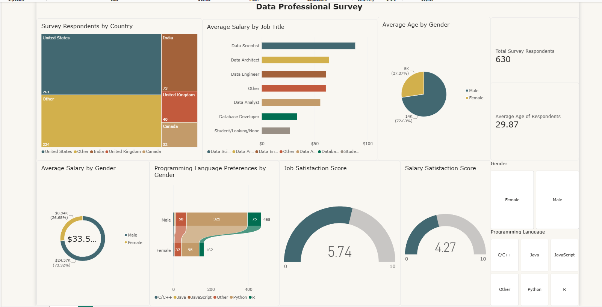

# 📊 Data Professional Survey Dashboard — Power BI

## Project Overview

This project analyzes a survey of **630 data professionals** using **Microsoft Power BI**.

The dashboard was created to understand:

- Where survey respondents are located
- Which data roles have the highest average salaries
- Respondent age and gender distribution
- Programming language preferences
- Job satisfaction
- Salary satisfaction

The goal was to transform survey data into a simple, interactive dashboard that makes career and workforce trends easy to understand.

---

## Key Metrics

| KPI | Result |
|---|---:|
| **Total Survey Respondents** | **630** |
| **Average Age** | **29.87 years** |
| **Job Satisfaction Score** | **5.74 / 10** |
| **Salary Satisfaction Score** | **4.27 / 10** |

---

## Key Insights

### 🌎 Most Respondents Are from the United States

The **United States** had the largest number of survey respondents with **261 people**.

Other respondent groups included:

- Other countries — **224**
- India — **73**
- United Kingdom — **40**
- Canada — **32**

This shows that the survey has a strong U.S. representation while still including professionals from several international markets.

---

### 💰 Data Scientists Earn the Highest Average Salary

Among the job titles shown in the dashboard, **Data Scientist** had the highest average salary.

Other roles such as **Data Architect, Data Engineer, Other, and Data Analyst** followed, while **Student/Looking/None** had the lowest average salary.

This comparison helps show how salary differs across data-related career paths.

---

### 👨‍💻 Python Is the Most Popular Programming Language

The programming-language analysis shows that **Python is the most preferred language** among the surveyed data professionals.

Other languages in the dashboard include:

- R
- JavaScript
- Java
- C/C++
- Other

Python's strong preference highlights its importance in data analytics, data science, and related technical roles.

---

### 😊 Job Satisfaction Is Higher Than Salary Satisfaction

The average **job satisfaction score is 5.74/10**, while the average **salary satisfaction score is 4.27/10**.

This suggests that respondents are generally more satisfied with their work than with their compensation.

---

### 👥 Respondent Demographics

The dashboard also compares survey results by **gender**, including:

- Average salary
- Age distribution
- Programming language preferences

Interactive filters make it easy to explore how results change across different respondent groups.

---

## Dashboard Features

The dashboard includes:

- Total Respondents KPI
- Average Age KPI
- Survey Respondents by Country
- Average Salary by Job Title
- Average Age by Gender
- Average Salary by Gender
- Programming Language Preferences by Gender
- Job Satisfaction Gauge
- Salary Satisfaction Gauge
- Gender Slicer
- Programming Language Slicer

---

## Skills Demonstrated

This project demonstrates practical experience with:

- **Microsoft Power BI**
- **Power Query**
- **Data Cleaning**
- **Data Transformation**
- **Data Visualization**
- **Dashboard Design**
- **KPI Development**
- **Slicers and Interactive Filters**
- **Survey Data Analysis**
- **Business Storytelling**

---

## Key Takeaways

- The **United States** represents the largest respondent group.
- **Data Scientist** is the highest-paying role shown in the dashboard.
- **Python** is the most popular programming language.
- Respondents report **higher job satisfaction than salary satisfaction**.
- The average respondent is approximately **30 years old**.

---

## Future Improvements

For the next version of this project, I would add:

- Salary analysis by country
- Salary analysis by experience level
- Job satisfaction by job title
- Salary satisfaction by role
- Programming language preference by job title
- More advanced drill-through pages and tooltips

---

## Tools Used

**Power BI | Power Query | Data Visualization | Survey Analysis | Dashboard Design**

---

## Author

**Mohammad**

Portfolio:  
https://mohammad0104.github.io/
